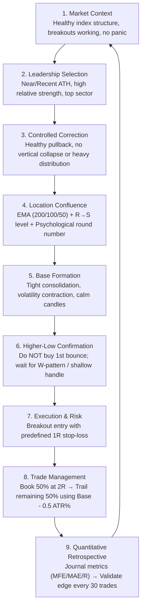
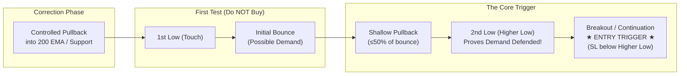
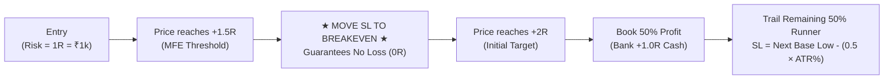

# Professional Trading Strategy Playbook
### Structural Pullback & Volatility Contraction Framework (Level-3)

---

## 1. Executive Summary & Core Philosophy

### The Strategy in One Sentence
> **Strong stock → Healthy correction → Key support confluence → Higher-low / W-base confirmation → Breakout continuation.**

### The Core Dictum
> ### *"The EMA doesn’t create the trade — the base does."*

* **Structure Over Narrative**: Markets are directionally unpredictable; no one can reliably call tops or bottoms. Sustainable edge comes from trading price structure and auction mechanics, not stock stories or corporate narratives. An average-looking stock in a valid technical setup will consistently outperform a famous market darling with broken structure.
* **Opportunity Clusters**: Setups do not arrive evenly day-to-day. They arrive in **phases and clusters**—most abundantly right after sharp, news-driven market corrections when genuine bases form. Quiet periods between setups are the system functioning properly, not a sign that it is broken.
* **Capital Protection First**: Survival precedes growth. Protect downside with absolute discipline, and let well-managed winners drive compounding.

---

## 2. System Architecture & Visual Framework

### End-to-End Trade Lifecycle



---

### The Refined Entry Trigger Anatomy (W-Base / Shallow Handle)



> [!IMPORTANT]
> **The Logic Behind the Refined Trigger**:
> * The **first touch** of support proves nothing.
> * The **bounce** merely suggests possible demand.
> * The **higher low** proves that buyers are actively stepping in and defending the stock at a higher, more aggressive price.
> * Buying the higher low prevents bottom-fishing and gives you a tight, logical invalidation level.

---

## 3. Strategy Matrix: Swing vs. Positional

| Parameter | Swing Strategy | Positional Strategy (200 WEMA System) |
| :--- | :--- | :--- |
| **Timeframe** | Daily chart (`1D`) | Weekly chart (`1W` / Friday Close) |
| **Prior Trend / ATH** | Fresh All-Time High within **$\le$ 180 trading days** | 52-Week High within past **$\le$ 52 weeks** (min 6 weeks age) |
| **Pullback Zone** | Daily 200 EMA (or 50 / 100 EMA) approached from **above** | **Weekly 200 WEMA** ($+3\%$ touch zone, $\le -5\%$ wick buffer) |
| **Bounce Count Limit** | **1st test = Prime (A+)**; 2nd = Acceptable; **3rd+ = Disqualified** | 1st or 2nd structural test on primary secular trend |
| **Structural Level** | Resistance-turned-Support (R $\rightarrow$ S) required | Multi-year secular accumulation bedrock |
| **Sector Filter** | Sector must be **above its own 200 EMA** & showing RS | Sector in Stage 2 or consolidating above key weekly EMAs |
| **Market Regime** | Broader market (Nifty) in **pullback / sell-off digestion** | **MANDATORY**: Nifty 50 must be **above its 50-Week EMA** |
| **Base Pattern** | W-base or shallow base (4–12 daily candles) | Weekly base consolidation (**3 to 10 weekly candles**) |
| **Confirmation Pivot** | Higher Low / W-bottom before entry | W-bottom inside weekly base (second half low $\ge 98.5\%$ first half) |
| **Entry Trigger** | Daily breakout above W-base high | Daily candle crossing above the **highest high of the weekly base** |
| **Stop-Loss (SL)** | **4% – 6%** (tight, under base higher low) | **8% – 12%** (weekly base low minus $0.3 \times \text{Weekly ATR}$) |
| **Breakeven Rule** | **Mandatory Move to BE at $+1.5\text{R}$** | **Mandatory Move to BE at $+1.5\text{R}$** (Prevents *Voltas* round trips) |
| **Profit Taking** | **Book 50% at $+2\text{R}$**; trail remainder | **Book 50% at $+2.5\text{R}$ to $+3.0\text{R}$**; trail remainder |
| **Trailing Method** | Base low minus $0.5 \times \text{ATR}$ | Trail below low of subsequent higher weekly consolidation bases |
| **Holding Period** | **2 weeks to 1–2 months** | **3 months to 9 months** (Average winner: ~166 days) |
| **Risk Modeling** | Fixed **₹1,000 per trade (1R = ₹1k)** | Fixed **₹1,000 per trade (1R = ₹1k)** |

---

### The Positional 200 WEMA System: Quantitative Validation (2018–2026)

Across the **Nifty 500 universe** over an 8.5-year dataset (~2,160 daily bars / ~450 weekly bars):
* **With Market Regime Filter (Nifty above 50 WEMA)**:
  * **Profit Factor**: **2.44**
  * **Total Realized Payoff**: **$+23.35\text{R}$** ($+₹23,382.70$)
  * **Average Winner**: **$+3.30\text{R}$** (Hold time: $166.8$ days)
  * **Average Loser**: **$-1.02\text{R}$** (Hold time: $63.2$ days)
  * **Round-Trip Failures**: **0** (eliminated completely by $+1.5\text{R}$ Breakeven rule)
* **The 2026 Market Regime Finding**:
  * Between March 2026 and September 2026, Nifty dropped below its 50-week EMA ($24,900 \rightarrow 23,100$).
  * The systematic engine refused to take any trades in 2026, preserving $100\%$ of capital.
  * When tested *without* the market filter, 2026 trades suffered a **$100\%$ failure rate** (e.g. *UTI AMC*, *Asian Paints*, *Reliance*).
  * **Core Law**: *Positional trading demands a secular market tailwind (Nifty above 50 WEMA). While swing trades can exploit 5–15 day counter-trend slingshots, positional trades will always get dragged down by prolonged macro distribution.*

---

## 4. The Refined Entry Trigger & Mechanical Rules

The entry trigger is strictly rules-based. The Special 30 Retrospective demonstrated that **63% of historical stoplosses were completely avoidable** by adhering to these mechanical criteria:

### The Core Prerequisites (Binary Go / No-Go)
1. **The 180-Day ATH Rule**:
   * The stock must have printed a fresh 52-week All-Time High within the preceding **180 trading days** (~6–8 months).
   * Stocks in long multi-year downtrends or sideways consolidations without a recent ATH are disqualified (e.g. *NTPC*, *Tata Power* retrospective errors).
2. **The Top-Down Vector Rule (Pullback vs. Inversion)**:
   * Price must approach the 200 EMA **from above** (a healthy pullback from the ATH).
   * **Strictly Disqualified**: Price rising *upwards* into the 200 EMA from deep below (e.g. *Fortis*, *Anupam Rasayan*). That is an overhead resistance test, not a demand test.
3. **The First-Bounce Rule (The Rule of Exhaustion)**:
   * **1st Touch / Pullback after ATH**: **Highest Probability (A+)**. Retrospective demonstrated a **66.7% win rate** on first bounces.
   * **2nd Touch**: Acceptable only if accompanied by a clear higher low and strong sector tailwind.
   * **3rd Touch / Late Stage**: **Strictly Disqualified**. By the third test, institutional absorption is exhausted, resulting in an **83.3% breakdown rate** (e.g. *BEL* 3rd bounce).
4. **Sector Alignment Filter**:
   * The underlying sector index must be trading **above its own 200 EMA**.
   * Avoid stocks whose sector is in a downtrend or trading below its 200 EMA (e.g. *Tata Consumer* with FMCG weak, *JK Tyre* with auto-ancillary weak). Never buy sector laggards (e.g. *Hero MotoCorp* while *TVS* leads).
5. **Broader Market Timing (The Nifty Reset Edge)**:
   * **100% of historical winners** in the retrospective occurred when entries were timed right after a broader market (Nifty) sell-off or pullback digestion.
   * Do not initiate fresh swing breakouts when the broader market is overextended, frothy, or failing to hold key short-term moving averages.

---

## 5. Pullback & Support Confluence Framework

A pullback alone is never a trade. You are seeking a **controlled correction within a dominant Stage 2 uptrend**:

### Support Confluence Elements
The strongest entries occur where multiple independent pieces of structural evidence intersect:
* **Key Moving Average Floor**: Daily 200 EMA approached from above.
* **Prior Breakout Level ($R \rightarrow S$)**: Previous major horizontal resistance acting as new support (present in $64\%$ of winning setups).
* **Multi-Candle Base Formation**: A tight, calm base of **4 to 12 daily candles** showing volatility contraction.
* **Higher Low / W-Base Confirmation**: Do **NOT** buy the first touch or the first single green bounce candle (e.g. *BEL* 21-May hurry trade). Wait for the second, higher pivot low to prove demand defense.

```text
PRIME SETUP CONFLUENCE (A+):
[ Fresh ATH < 180 Days ] + [ 1st 200 EMA Test from Above ] + [ Prior R→S Level ] + [ 4-12 Day W-Base ] + [ Nifty Pullback Reset ]
```

### The "Anti-Patterns" (Immediate Disqualification)
Disqualify any candidate exhibiting:
* **Inverted Approach**: Price coming up from underneath a declining 200 EMA.
* **3rd or 4th Test**: Churning around the 200 EMA repeatedly.
* **Sector Laggard**: Stock trading significantly below its 200 EMA while peers are at highs.
* **No Base**: A single spike or hammer with zero multi-day consolidation.
* **Earnings Risk**: Within 7–10 trading days before earnings.

---

## 6. Exit, Trailing & Runner Management

The retrospective proved that **trade management is equal in importance to trade selection**. Letting $+1.8\text{R}$ and $+1.9\text{R}$ trades reverse into $-1\text{R}$ losses severely damaged the equity curve.



### 1. The Round-Trip Protection Rule (Mandatory)
* **Trigger at $+1.5\text{R}$ Excursion**:
  * As soon as price reaches **$+1.5\text{R}$**, the stop-loss must be moved to **Breakeven (Cost + Charges)**.
  * A trade that produces a $+1.5\text{R}$ favorable excursion is **never permitted to become a losing trade**.
  * Retrospective impact: Applying this rule converts the *TVS Motors* (+1.8R peak) and *Indian Bank* (+1.9R peak) $-1\text{R}$ losses into risk-free trades.

### 2. The Two-Tranche Exit Strategy
* **Tranche 1 (50% of Position)**:
  * Book profit at **$+2\text{R}$**.
  * Banks $+1.0\text{R}$ in cash, locks in trade expectancy, and eliminates emotional stress.
* **Tranche 2 (Remaining 50% Runner)**:
  * Maintain trailing stop at Breakeven until the next daily base forms along the trend.
  * Once the next base forms and confirms, trail the stop to:
    $$\text{Trailing SL} = \text{New Base Low} - (0.5 \times \text{ATR}\%)$$
  * Allows the trader to capture multi-bagger runners (e.g. *CUB* running to $+7\text{R}$, *TVS* running to $+6\text{R}$, *APL Apollo* running to $+5.5\text{R}$).

---

## 7. Risk, Capital & Retrospective Validation

### 1. The Fixed 1R Baseline
* **Current Risk Allocation**: Fixed **₹1,000 per trade (1R = ₹1k)** across all swing trades (~0.5% of ~₹2,00,000 active capital).
* **Automated Risk Engine**:
  * Quantity is sized dynamically so that:
    $$\text{Quantity} = \frac{\text{₹}1,000}{\text{Entry Price} - \text{Stop Loss Price}}$$
  * When manual SL is omitted, implied SL is automatically calculated by the journal formulas.
* **Absolute Ban on Averaging Down**:
  * A swing trade is a single, discrete probabilistic event.
  * **Strict Rule**: Never add shares to an open losing swing trade (e.g. *GRSE* 20-Jul violation). If stopped out, take the loss.

### 2. The Special 30 Swing Retrospective Benchmark
The deep-dive review of the first 30 swing trades revealed the true potential of the system once behavioral and filtering leaks are sealed:

| Execution Cohort | Trades | Wins | Losses | Win Rate | Net P&L | Net R-Multiple | Diagnostic Takeaway |
| :--- | :---: | :---: | :---: | :---: | :---: | :---: | :--- |
| **Actual Baseline (Raw Journal)** | **30** | **11** | **19** | **36.7%** | **+₹973.79** | **+0.97R** | Baseline performance dragged down by 12 non-conforming trades. |
| **Filtered: Strict Rules Applied** | **18** | **11** | **7** | **61.1%** | **+₹13,608.64** | **+13.61R** | Eliminating 12 avoidable trades jumps win rate to 61% and P&L 14x. |
| **Filtered + Breakeven at $+1.5\text{R}$** | **18** | **11** | **5** *(2 BE)* | **61.1%** | **+₹15,862.68** | **+15.86R** | Eliminates 2 round-trip failures (*TVS*, *Indian Bank*). |
| **Filtered + 50% Partial at $+1.5\text{R}/+2\text{R}$** | **18** | **13** | **5** | **72.2%** | **+₹17,362.68** | **+17.36R** | **Target Playbook Model**: High win rate, protected capital, massive runner upside. |

---

## 8. Earnings & Contextual Awareness

* **Technical Setup = Primary; Earnings = Conviction Layer**. Fundamentals or earnings never substitute for a technical base, nor do they override risk management.
* **Event Risk Blackout**: Avoid taking fresh swing entries within **7–10 trading days** of an upcoming earnings release.
* **Post-Earnings Conviction**:
  * Good earnings + valid base holding support = higher conviction.
  * Weak/mixed earnings = lower conviction, skip, or demand a tighter base.

---

## 9. Trend Stage & Market Regime Awareness

### Trend Stage Categorization (Stan Weinstein Framework)
* **Stage 1 (Accumulation)**: Sideways basing after a downtrend. Ignore.
* **Stage 2 (Advancing Phase)**: Price breaking out, 200 EMA rising, series of higher highs and higher lows. **This is where 100% of strategy trades must live.**
* **Stage 3 (Distribution / Late Stage)**: Volatile, wide swings, multiple breakout failures, stock up several hundred percent. **Avoid new entries.**

### Market Regime (Nifty 50 Alignment)
The strategy performs best with the wind at your back:
* **Bullish / Trending Market** (Nifty > 20 EMA, 20 EMA > 50 EMA): Aggressive deployment, full position sizing.
* **Pullback / Corrective Market** (Nifty below 20 EMA or testing 50 EMA): **Prime Setup Window** — watch for high-RS leaders testing 200 EMA as Nifty bottoms out.
* **Hostile / Panic Market** (Nifty below 50 EMA and cascading): Cash is a valid position. Wait for the post-correction base cluster.

---

## 10. Psychology & Execution Rules

1. **Verify the Ticker (Fat-Finger Prevention)**: Always confirm the stock symbol in the order window before clicking buy (avoids errors like *Tata Communications* instead of *Tata Consumer*).
2. **Respect the Cooldown Period**: If stopped out of a stock, observe a mandatory **minimum 5-day cooldown**. Never take an immediate re-entry on a single candle (avoids revenge trades like *BEL* on 21-May).
3. **Stop Micromanaging**: Once an order is executed, step back. Let the predefined stop and target structure do the work.
4. **Tolerate Normal Pullbacks**: After booking 50% at 2R, give the runner room. A stock moving from $+3\text{R}$ back toward $+1.5\text{R}$ is normal trend volatility, not a failure.
5. **Stop-Loss $\ne$ Bad Stock**: A stop-out simply means *this specific setup failed*.
6. **Research Over Emotion**:
   $$\text{Observation} \longrightarrow \text{Hypothesis} \longrightarrow \text{Trade Data} \longrightarrow \text{30-Trade Retro} \longrightarrow \text{Validation} \longrightarrow \text{Rule}$$

---

## 11. Pre-Flight Checklist (Binary Go / No-Go)

Every trade must score **100% YES** across all items before order placement:

### A. Core Strategy Eligibility (Disqualification Check)
* [ ] **180-Day ATH**: Did the stock hit a 52-week All-Time High within the past 180 trading days?
* [ ] **Top-Down Approach**: Is the price approaching the 200 EMA from *above* (pullback), not rising from below?
* [ ] **Bounce Count**: Is this the **1st bounce** (or valid 2nd bounce with higher low) after ATH? *(3rd bounce = AUTO-DISQUALIFY)*.
* [ ] **Sector Trend**: Is the underlying sector index trading **above its 200 EMA**?
* [ ] **Market Context**: Has the broader market (Nifty) experienced a pullback / digestion to provide slingshot fuel?

### B. Base & Entry Quality
* [ ] **Base Duration**: Has a distinct base of **4 to 12 daily candles** formed at the support zone?
* [ ] **No Bottom-Fishing**: Did you avoid buying the first touch / single green candle?
* [ ] **Higher Low / W-Pattern**: Has a confirmed higher low or W-pattern pivot formed?
* [ ] **Resistance-to-Support**: Is there prior horizontal breakout resistance acting as support ($R \rightarrow S$)?
* [ ] **No Earnings Climax**: Is the upcoming earnings date at least 7–10 trading days away?

### C. Execution, Sizing & Protection
* [ ] **Correct Symbol**: Order ticket verified against intended watchlist symbol.
* [ ] **Risk Sized to 1R**: Quantity calculated strictly to risk **₹1,000 (1R)**.
* [ ] **Breakeven Alert Set**: Alert placed at **$+1.5\text{R}$** to trail SL to Breakeven.
* [ ] **Partial Target Set**: GTT / limit order ready to book **50% at $+2\text{R}$**, with trailing rule planned for remainder.
* [ ] **No Averaging Down**: Absolute commitment to take the stop if the base pivot breaks.
