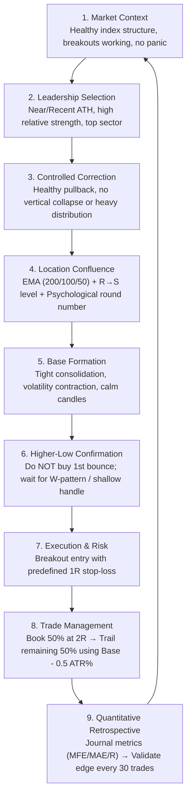
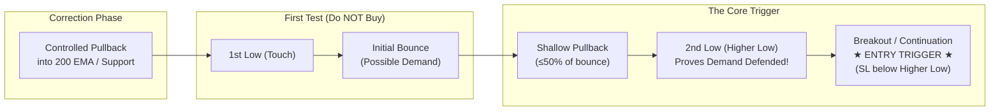
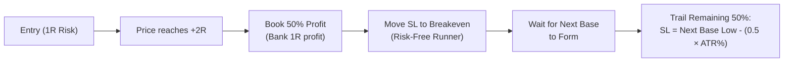
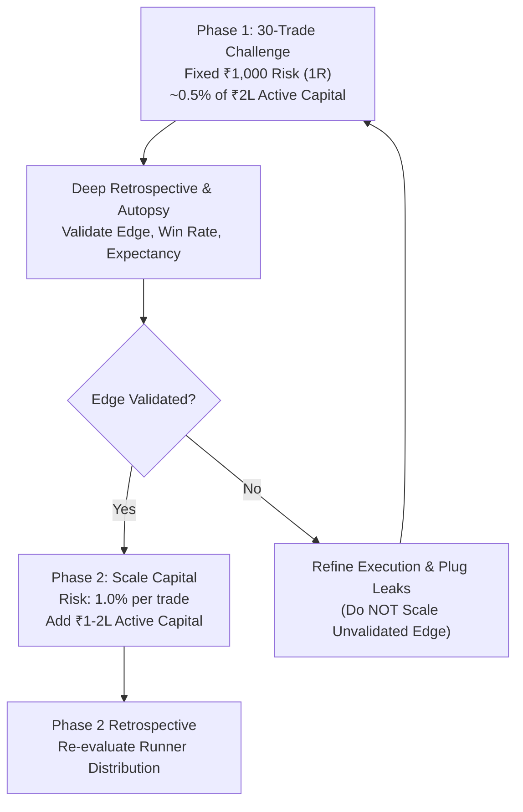

# Professional Trading Strategy Playbook
### Structural Pullback & Volatility Contraction Framework (Level-3)

---

## 1. Executive Summary & Core Philosophy

### The Strategy in One Sentence
> **Strong stock → Healthy correction → Key support confluence → Higher-low / W-base confirmation → Breakout continuation.**

### The Core Dictum
> ### *"The EMA doesn’t create the trade — the base does."*

* **Structure Over Narrative**: Markets are directionally unpredictable; no one can reliably call tops or bottoms. Sustainable edge comes from trading price structure and auction mechanics, not stock stories or corporate narratives. An average-looking stock in a valid technical setup will consistently outperform a famous market darling with broken structure.
* **Opportunity Clusters**: Setups do not arrive evenly day-to-day. They arrive in **phases and clusters**—most abundantly right after sharp, news-driven market corrections when genuine bases form. Quiet periods between setups are the system functioning properly, not a sign that it is broken.
* **Capital Protection First**: Survival precedes growth. Protect downside with absolute discipline, and let well-managed winners drive compounding.

---

## 2. System Architecture & Visual Framework

### End-to-End Trade Lifecycle



---

### The Refined Entry Trigger Anatomy (W-Base / Shallow Handle)



> [!IMPORTANT]
> **The Logic Behind the Refined Trigger**:
> * The **first touch** of support proves nothing.
> * The **bounce** merely suggests possible demand.
> * The **higher low** proves that buyers are actively stepping in and defending the stock at a higher, more aggressive price.
> * Buying the higher low prevents bottom-fishing and gives you a tight, logical invalidation level.

---

## 3. Strategy Matrix: Swing vs. Positional

| Parameter | Swing Strategy | Positional Strategy |
| :--- | :--- | :--- |
| **Timeframe** | Daily chart | Weekly chart |
| **Prior Trend / ATH** | Recent 52-week All-Time High | ATH within the past ~1 year |
| **Pullback Zone** | Daily 200 EMA (or 50 / 100 EMA) | Weekly 200 WEMA / Major base support |
| **Structural Level** | Resistance-turned-Support (R $\rightarrow$ S) required | Resistance-turned-Support (R $\rightarrow$ S) required |
| **Sector Filter** | Sector must rank in the **Top 3 strongest** | Sector strength is a supporting nuance |
| **Base Pattern** | W-base or shallow cup & handle on Daily | Base / consolidation on Weekly |
| **Stop-Loss (SL)** | **4% – 6%** (tight, under higher low) | **8% – 10%** (room for weekly fluctuations) |
| **Holding Period** | **2 weeks to 1–2 months** | **6 months to 12 months** |
| **Pyramiding** | No (clean swing execution) | **Yes** (add 50% of remaining qty on next base) |

---

## 4. The Refined Entry Trigger (The Core Edge)

The entry trigger applies equally to both Swing and Positional frameworks. It is strictly rules-based:

1. **Location Touch**: Price reaches an important structural support zone:
   * Daily 200 EMA / Weekly 200 WEMA
   * Prior Resistance-turned-Support ($R \rightarrow S$)
   * Key psychological round number
2. **Pattern Formation**: Forms a **W-shaped base** or **shallow cup-with-handle** structure.
3. **No Bottom-Fishing**: **Do NOT buy the first bounce or the absolute low.**
4. **The Higher Low (The Handle)**: Wait for the second, higher low after the initial bounce. This higher low is the actual confirmation signal.
5. **Shallow Retracement**: The handle should be tight and shallow—ideally **$\le 50\%$ retracement of the first bounce**. 
   * Shallow handles indicate high buyer urgency, offer tighter stops, and yield superior risk-reward.
6. **Deliberate Design — No Volume Filter**:
   * *The Level-3 playbook operates with no mandatory volume filter on entry by design.*
   * This keeps the core system purely price-and-structure based, avoiding unnecessary indicator complexity.

---

## 5. Pullback & Support Confluence Framework

A pullback alone is never a trade. You are seeking a **controlled correction within a dominant uptrend**:

### Support Confluence Elements
The strongest entries occur where multiple independent pieces of structural evidence intersect:
* **Moving Average Context**: 200 EMA (deep correction), 100 EMA (intermediate), 50 EMA (healthy leader), or 20 EMA (super-leader).
* **Prior Breakout Level**: Previous major horizontal resistance acting as new support ($R \rightarrow S$).
* **Psychological Round Numbers**: High-volume institutional clearing levels (e.g. ₹100, ₹500, ₹1,000, ₹2,000).

```text
CONFLUENCE POWER:
[ Key Moving Average ] + [ Prior Breakout R→S ] + [ Round Psychological Number ] = High-Conviction Floor
```

### What Disqualifies a Setup (Signs of Trend Failure)
Avoid stocks displaying:
* Vertical, waterfall collapses.
* Massive, wide-ranging impulsive red distribution candles.
* Panic selling with heavy, climax volume.
* Repeatedly weak, limp reclaim attempts.
* Wide, loose, erratic, and sloppy bases.

> [!TIP]
> **Correction $\ne$ Trend Failure**. A healthy correction digests prior gains in an orderly, contracting fashion. If the structure breaks violently, the stock is disqualified.

---

## 6. Exit, Trailing & Runner Management

A system's win rate determines psychological comfort; its **winner management** determines the slope of your equity curve.



### 1. The Two-Tranche Exit Rule
* **Tranche 1 (50% of Position)**: Book profit at exactly **$+2\text{R}$**. This locks in gains, finances the trade risk, and protects psychology.
* **Tranche 2 (Remaining 50%)**: Let it run as a multi-week / multi-month trend runner.
  * Move initial stop loss to **Breakeven** once $+1.5\text{R}$ to $+2\text{R}$ is reached.
  * Wait for the next base/consolidation to form along the trend.
  * Trail the stop loss to:
    $$\text{Trailing SL} = \text{New Base Low} - (0.5 \times \text{ATR}\%)$$
    *(Example: If ATR is 5%, place the stop 2.5% below the new base low).*

### 2. Positional Pyramiding (Positional Strategy Only)
* If a new valid base forms after the $+2\text{R}$ milestone and confirms support:
  * **Add 50% of the remaining quantity**.
  * A single, common trailing stop loss applies to the entire position (original + add).
  * If the new base breaks down, reduce or cut the position immediately.
* **Open Risk Item**: A strict maximum exposure cap (e.g., maximum 2 adds or max 20% portfolio allocation) must be observed before scaling capital.

---

## 7. Risk, Capital & Challenge Roadmap



### Risk Rules
* **Predefined Risk (1R)**: Exact stop-loss price and share quantity are determined before clicking buy.
* **Strict Fixed Risk**: Currently fixed at **₹1,000 per trade** (~0.5% of ~₹2,00,000 active trading capital).
* **Capital Protection Axiom**:
  > **"Never scale capital on an unvalidated edge. Each cycle must earn the right to the next size up."**
* **Idle Capital Productivity**:
  * Unused cash (~₹2–3 Lakhs) is parked in **Liquid Funds / LiquidBees**.
  * Instant liquidity to redeploy when a valid A-grade setup appears.
  * **Strictly No Margin Trading Facility (MTF)**, no borrowing, and no equity delivery pledging. Trade cash delivery only.

### Options Strategy: Deliberately Parked
* Extensive live testing on Nifty iron condors and short strangles showed that the required breakeven win rate (80%–93%) consistently exceeded the platform's probability of profit by 8–11 percentage points.
* Under prevailing low-VIX market regimes ($\approx 12–14$), premium selling offers negative mathematical expectancy.
* **Decision**: Kept completely parked. Equity swing and positional trading remain the two sole pillars.

---

## 8. Earnings & Contextual Awareness

* **Technical Setup = Primary; Earnings = Conviction Layer**. Fundamentals or earnings never substitute for a technical base, nor do they override risk management.
* **Event Risk Blackout**: Avoid taking fresh swing entries within **7–10 trading days** of an upcoming earnings release.
* **Post-Earnings Conviction**:
  * Good earnings + valid base holding support = higher conviction.
  * Weak/mixed earnings = lower conviction, skip, or demand a tighter base.
* **Ongoing Research**: Track whether post-earnings entries show superior expectancy across each 30-trade block before promoting this to a mandatory hard rule.

---

## 9. Trend Stage & Market Regime Awareness

### Trend Stage Categorization (Stan Weinstein Framework)
* **Stage 1 (Accumulation)**: Sideways basing after a downtrend. Ignore.
* **Stage 2 (Advancing Phase)**: Price breaking out, 200 EMA rising, series of higher highs and higher lows. **This is where 100% of strategy trades must live.**
* **Stage 3 (Distribution / Late Stage)**: Volatile, wide swings, multiple breakout failures, stock up several hundred percent. **Avoid new entries.**

### Market Regime (Nifty 50 Alignment)
The strategy performs best with the wind at your back:
* **Bullish / Trending Market** (Nifty > 20 EMA, 20 EMA > 50 EMA): Aggressive deployment, full position sizing.
* **Pullback / Corrective Market** (Nifty below 20 EMA or testing 50 EMA): Tighten entry selectivity, demand shallower handles, cut watchlist size.
* **Hostile / Panic Market** (Nifty below 50 EMA): Cash is a valid position. Wait for the post-correction base cluster.

---

## 10. Psychology & Execution Rules

1. **Stop Micromanaging**: Once an order is executed, step back. Do not watch tick-by-tick candles or calculate paper P&L intra-day. Let the predefined stop and target structure do the work.
2. **Tolerate Normal Pullbacks**: After booking 50% at 2R, give the runner room. A stock moving from $+3\text{R}$ back toward $+1.5\text{R}$ is normal trend volatility, not a failure.
3. **Stop-Loss $\ne$ Bad Stock**: A stop-out simply means *this specific setup failed*. If the stock resets, stabilizes, and builds a fresh, valid W-base with a higher low, a **re-entry** is treated as a clean, independent opportunity.
4. **Research Over Emotion**:
   $$\text{Observation} \longrightarrow \text{Hypothesis} \longrightarrow \text{Trade Data} \longrightarrow \text{30-Trade Retro} \longrightarrow \text{Validation} \longrightarrow \text{Rule}$$
   Never promote a single good or bad chart into an emotional rule.

---

## 11. Pre-Flight Checklist (The Single-Screen Filter)

Before entering any trade, verify all boxes:

### A. Market & Sector Context
* [ ] Broad market index (Nifty 50 / 500) structure is healthy and not in free-fall.
* [ ] Sector ranks among the top performers showing relative strength.

### B. Stock Leadership
* [ ] Stock is near or within ~20% of its 52-week All-Time High.
* [ ] Clean prior Stage 2 uptrend (not a late-stage exhausted runner).
* [ ] Stock is fundamentally resilient (no upcoming earnings within 7–10 days).

### C. The Correction & Location
* [ ] Controlled, orderly correction (no vertical panic or wide red bars).
* [ ] Price has arrived at key confluence: 200 EMA / 50 EMA / Prior Breakout ($R \rightarrow S$) / Round Number.

### D. The Base & Confirmation (The Edge)
* [ ] Volatility has contracted into a tight, quiet base.
* [ ] Did **NOT** buy the first touch or initial bounce.
* [ ] A distinct **W-pattern** or **higher low / handle** has formed.
* [ ] Handle is shallow ($\le 50\%$ retracement of the initial bounce).

### E. Execution & Risk Parameters
* [ ] Predefined stop-loss set below the higher-low base pivot.
* [ ] Total capital risk strictly calculated to exactly **₹1,000 (1R)**.
* [ ] Profit target set to book **50% at $+2\text{R}$**, with trailing plan prepared for the remaining half.
